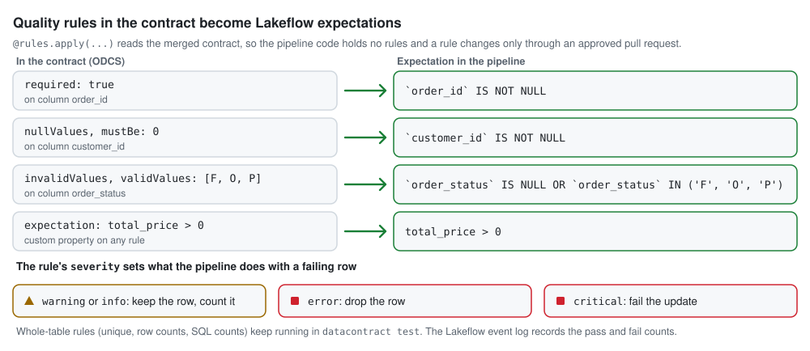
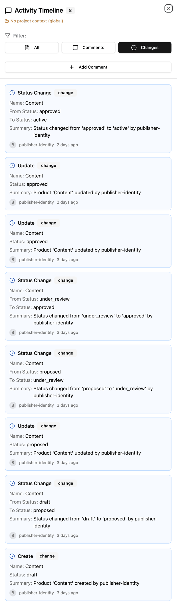
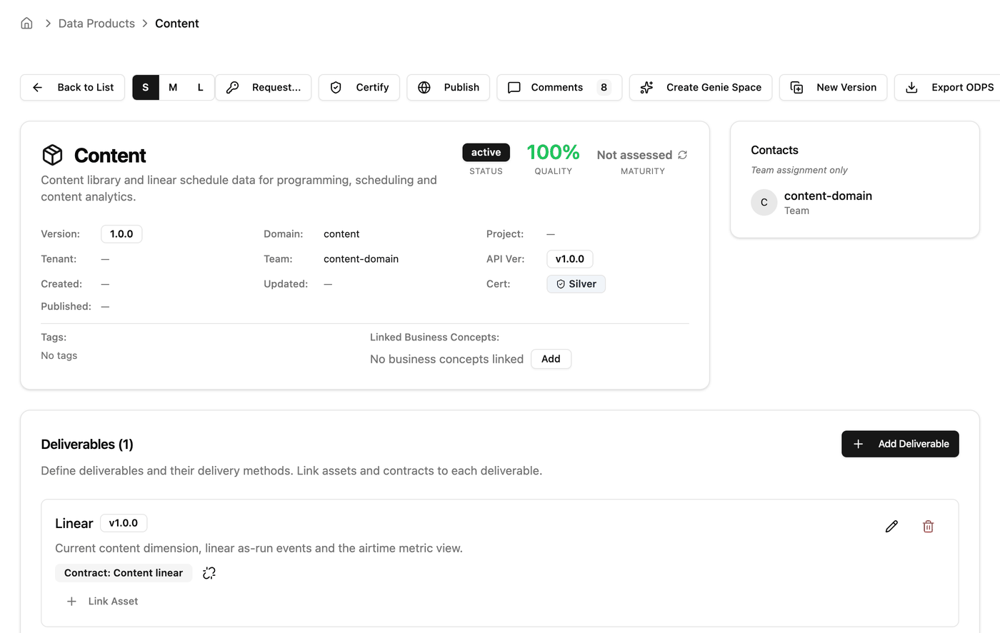

# Lakehouse Governance as Code

**The pipeline decides, the Data Steward signs, Unity Catalog enforces.**

[](LICENSE)
[](https://bitol-io.github.io/open-data-contract-standard/)
[](https://bitol-io.github.io/open-data-product-standard/)

Most governance lives in policy documents and depends on people remembering them. This
repository turns the policy into checks and pipeline steps on Databricks.

You describe each dataset in a data contract, a YAML file in git. A change is a pull request.
CI checks it against your standard, and the Data Steward approves it. After the merge, the
pipelines build the data with the contract's quality rules, then set Unity Catalog and
[Ontos](https://github.com/databrickslabs/ontos) to match. Nothing is applied by hand, so what
runs is always what was approved. No secret is stored anywhere.

It is for data platform teams on Databricks who want ownership, quality and access to be
enforced, not just written down.

<picture>
  <source media="(prefers-color-scheme: dark)" srcset="docs/assets/how-it-works-dark.svg">
  
</picture>

**[Read how it works, step by step](docs/how-it-works.md)**

## What it gives you

- **A standard that cannot be skipped.** A contract without a named Data Steward and Business
  Data Owner, a domain, a status or a classification fails the pull request.
- **An approval that is recorded.** The product's Data Stewards sign off by approving the pull
  request, so the pull request records who approved what, and when.
- **Quality rules in one place.** The rules live in the contract and run inside the product's
  pipeline. Nobody copies them into code.
- **A catalogue that matches reality.** After the merge, comments, tags and grants in Unity
  Catalog are set from the contract. A grant nobody approved is revoked.
- **A clear lifecycle.** A product moves from draft to active through four gates, and each gate
  is checked, not assumed.

## Governance on paper vs governance as code

| The policy says | What enforces it here |
|---|---|
| Every dataset has an accountable Data Steward and Business Data Owner | `dpi check-mandatory` fails the pull request until both are named in the contract |
| Changes are approved by the business | The product's Stewards group is a required reviewer on its folders; a direct push to `main` is refused |
| Data meets its quality rules | The contract's rules run as Lakeflow expectations in the product's pipeline; severity decides keep, drop or fail |
| The catalogue describes what is really there | Publish fails on schema drift between an object and its contract |
| Access matches the agreement | Publish makes the grants match the access file and revokes anything not listed |
| Every dataset is classified | Governed tags for tier, domain, status and sensitivity come from the contract, never by hand |
| Products are certified before people rely on them | The product reaches `active` (G4) only when its contracts are active and its objects exist; certification sets the Certified badge |

## Words used here

| Term | Meaning |
|---|---|
| Data contract | A YAML file in the [ODCS](https://bitol-io.github.io/open-data-contract-standard/) format: a dataset's columns, quality rules, owners, servers and status |
| Data product | A YAML file in the [ODPS](https://bitol-io.github.io/open-data-product-standard/) format: what a team publishes for others to use |
| Output port | One thing a data product publishes. Each port names a contract and its version |
| Data Producer | The engineer who builds a product and writes its contract |
| Data Steward | The person accountable for a product's data. Their pull request approval is the sign-off |
| Business Data Owner | The business person accountable for the data. Every contract names one |
| Governance tier | How much sign-off a contract needs. This repository implements the domain tier (2), where the Stewards approve. A contract at tier 1 (enterprise) fails CI until you add that sign-off |
| Publisher identity | The service identity the pipelines run as. It is the only writer to Unity Catalog metadata and Ontos |
| G1 to G4 | The lifecycle gates: `draft`, `proposed`, `approved`, `active` |
| Workload identity federation | How the pipelines sign in to Azure and Databricks without a stored secret |
| [Ontos](https://github.com/databrickslabs/ontos) | A Databricks Labs app that lists the contracts and products, with their status and quality. Here it is a display copy |

## How it works

A change goes through four steps. People do the first two. The pipelines do the last two, so
nothing is applied by hand.

Most steps run **`dpi`**, the command-line tool in this repository (short for data product
integration). It reads the contract files and the settings in `dp-integration/config/`, then
either checks them or applies them. Install it with `pip install ./dp-integration`. Two other
tools do the rest: `datacontract` from the open-source
[Data Contract CLI](https://cli.datacontract.com), and `databricks`, the Databricks CLI.

Under each step below are the commands that step runs. The pipelines run them for you; the
comment above each one says what it does. In the commands:

- `-e dev` or `-e prod` picks the environment: its workspace, catalogs and settings, from
  `dp-integration/config/environments/`. Checks that only read files need no environment.
- `contracts/**/*.odcs.yaml` means every contract file, and `products/**/*.odps.yaml` every
  product file.
- On your own machine, add `--profile <name>` to sign in with a Databricks CLI profile. The
  pipelines sign in as the publisher identity instead.

### 1. Create

A Data Producer describes the dataset in three files on a branch of `data-contracts`: the
contract, its access file and the product file. For a new product, the template writes all
three, and a bundle to build it. Then the Producer opens a pull request to `main`.

```bash
# Start a product called "returns" in the "sales" domain, at draft (G1).
dpi new-product --domain sales --product returns

# Optional: run the standard check before opening the pull request.
dpi check-mandatory contracts/**/*.odcs.yaml
```

[More on this step](docs/how-it-works.md#1-create).

### 2. Review and approve

Contract CI runs on the pull request. A blocking check that fails stops the merge and says
why. An advisory check only warns. When CI passes, a Data Steward of
the product approves the pull request in Azure DevOps, and the change merges.

```bash
# Blocking: the contract is valid ODCS. CI runs this for each contract.
datacontract lint contracts/sales/orders.odcs.yaml

# Blocking: every contract names a Data Steward and a Business Data Owner, and has a known
# domain and status, a governance tier and a security classification.
dpi check-mandatory contracts/**/*.odcs.yaml

# Blocking: every product points at contracts and versions that exist, and its domain is in
# the domain registry.
dpi check-products products/**/*.odps.yaml

# Advisory: run the contract's quality rules on the data in dev. "--server dev" picks the dev
# entry in the contract's servers. Flagged rows are a warning.
datacontract test --server dev contracts/sales/orders.odcs.yaml

# Blocking: each rule the pipeline will apply runs on the object in dev, so a typo or a
# missing column fails here, not in the next pipeline run. Flagged rows are only a warning.
dpi -e dev check-expectations contracts/**/*.odcs.yaml
```

[More on this step](docs/how-it-works.md#2-review-and-approve).

### 3. Build with the rules embedded

After the merge, the product's deploy pipeline builds it: in dev first, then in prod once
someone approves the prod deploy in Azure DevOps. The merged contract travels with the
bundle. In the pipeline code, `@rules.apply(...)` turns each of its row-level rules into a
Lakeflow expectation.

```bash
# From the bundle folder (dp-orders): copy in the merged contracts it lists, and the module
# that turns their rules into expectations.
../dp-integration/bin/fetch-rules.sh src/pipeline/contracts.txt ../data-contracts

# Check, deploy and run the bundle in dev. "-t dev" is the target in databricks.yml.
databricks bundle validate -t dev
databricks bundle deploy -t dev --auto-approve
databricks bundle run build -t dev
```

The prod stage runs the same with `-t prod`. [More on this step](docs/how-it-works.md#3-build-with-the-rules-embedded).

### 4. Publish and sync

The publish pipeline runs after every merge to `contracts/`, `products/` or `domains/`, and after
every deploy. It makes Unity Catalog and Ontos match `main`, as the publisher identity. It runs
in dev, then prod. Ontos is updated once, from one environment (prod here).

```bash
# In each environment: run the quality rules and keep the results for Ontos (advisory).
datacontract test --server prod contracts/sales/orders.odcs.yaml \
  --output quality/orders.odcs.yaml.json --output-format json

# In each environment: set comments, governed tags, contract properties and grants in Unity
# Catalog. Fails if an object no longer matches its contract. Add --dry-run to list the
# changes without making them.
dpi -e prod publish-uc contracts/**/*.odcs.yaml

# Once, in Ontos: the domains and their owner teams, from the domain registry.
dpi -e prod sync-domains domains/domains.yaml

# The contracts: each version, its status and the quality results from --quality-dir.
dpi -e prod sync-ontos --quality-dir quality contracts/**/*.odcs.yaml

# The data products: each one walks to the status in its file, one gate at a time (G1 to G4),
# and gets the certification level in its file.
dpi -e prod sync-products products/**/*.odps.yaml
```

[More on this step](docs/how-it-works.md#4-publish-and-sync).

## Quality rules become pipeline expectations

The rules live in the contract, so a rule changes only through a pull request the Stewards
approve. The pipeline code holds none.

<picture>
  <source media="(prefers-color-scheme: dark)" srcset="docs/assets/contract-to-expectation-dark.svg">
  
</picture>

In the contract:

```yaml
quality:
  - type: sql
    name: total_price_positive
    query: SELECT count(*) FROM ${object} WHERE total_price <= 0
    mustBe: 0
    severity: warning
    customProperties:
      - property: expectation
        value: total_price > 0
```

In the pipeline, a dataset only needs the decorator:

```python
rules = ContractExpectations.from_file(spark.conf.get("contract_path"))

@dp.materialized_view(name="orders", table_properties=rules.table_properties())
@rules.apply("orders")
def orders():
    ...
```

More: [Data products, bundles and pipeline rules](docs/15-data-products-bundles-and-pipeline-rules.md).

## What you see in Ontos

Approval happens in the pull request; Ontos shows the result. Every record in Ontos is written by
the publisher identity from `main`, so a status there can only move after a Steward approved the
change. That makes Ontos the place to see where each contract and product stands, and how it got
there.



**The activity timeline is the audit trail.** Open a data product and choose Comments, then
Changes. Each publish run that changes the product adds entries: the status before and after,
who made the change and when. Read from the bottom up, it is the product's path through the
gates:

- **Create** at `draft` (G1). A new product always starts here.
- **draft to proposed** (G2).
- **proposed to under_review to approved** (G3). `dpi sync-products` walks to the status in the
  product file one allowed step at a time, so Ontos's `under_review` step shows too.
- **approved to active** (G4), once the port contracts are active and the bundle has built the
  objects.

Every entry names the publisher identity, never a person: nobody edits Ontos by hand. To see who
approved a step, open the pull request that merged it.

<br clear="right">

**The product page shows where it stands now:** its status, quality score and certification
level, with each output port linked to its contract and version.



The contracts list, and the quality results the sync attaches to each contract version, are in
[How it works: what it looks like in Ontos](docs/how-it-works.md#what-it-looks-like-in-ontos).

## Try it in five minutes

You need Python 3.11 or later and nothing else: no Databricks, Azure or Ontos access.

```bash
git clone <this repository> && cd <repository folder>
python3 -m venv .venv && . .venv/bin/activate
pip install -e "./dp-integration[test]"
(cd dp-integration && python -m pytest -q)

cd data-contracts
export DP_CONFIG_DIR=../dp-integration/config
dpi check-mandatory contracts/*/*.odcs.yaml
dpi check-products products/*/*.odps.yaml
```

Both checks pass on the example, an Orders product in a `sales` domain. It reads
`samples.tpch.orders`, which every Databricks workspace has.

**See a change being stopped.** In `contracts/sales/orders.odcs.yaml`, delete the Data Steward
from `team` and run the check again:

```text
$ dpi check-mandatory contracts/*/*.odcs.yaml
ERROR   contracts/sales/orders.odcs.yaml:23: missing a named Data Steward
INFO    1 of 1 contracts failed the mandatory-field check
```

In a pull request, that is the check that blocks the merge. Put the Steward back and it passes.

**See the tier rule.** Set the contract's `governanceTier` to `1` and run it again:

```text
ERROR   contracts/sales/orders.odcs.yaml:125: governanceTier 1 is not set up on this platform, which publishes 2 (domain) (tags.tier_values in platform.yaml)
```

Set it back to `2` when you are done.

## Adopt it in your organisation

There are two ways in.

**The core needs no cloud.** The contracts, the `dpi` checks and the product template run
anywhere Python does. Use them in any CI to hold contracts to a standard before they merge.

**The full platform** adds the build and the publish. It runs on Azure DevOps, Azure Databricks
with Unity Catalog, and Ontos.

### Start a data product from the template

From a `data-contracts` checkout:

```bash
dpi new-product --domain sales --product returns
```

It writes the contract, the access file and the product file at `draft` (G1), and a bundle for
the product. All of them pass the blocking checks as they stand. Replace the `<placeholder>`
values and open the first pull request. A new domain also needs an entry in the domain registry.
See [Start a new data product](docs/16-start-a-new-data-product.md).

### Install the full platform

You need:

- An Azure subscription and a resource group for the publisher identity.
- An Azure Databricks Premium workspace with Unity Catalog, a serverless SQL warehouse,
  Databricks Apps and Lakebase Autoscaling.
- An Azure DevOps organisation connected to the same Entra ID tenant.
- A checkout of [Ontos](https://github.com/databrickslabs/ontos) v1.0.2, with its frontend built.
- On your machine: the Azure CLI with the `azure-devops` extension, the Databricks CLI 0.294 or
  later, Python 3.11 or later, Node.js (to build the Ontos frontend), git and rsync.

Follow the [install guide](docs/README.md). In short:

1. Record the decisions in [prerequisites](docs/02-prerequisites-and-decisions.md): tag names,
   environments, domains and who deploys bundles.
2. Fill in `dp-integration/config/environments/dev.yml` and `prod.yml`. Every value that is
   yours is a `<placeholder>`; a script that reads one still unset stops before it changes anything.
3. Run `scripts/split-repos.sh <organisation> <project>` and push the three repositories.
4. Run the setup scripts in `dp-integration/setup/`, in order: Unity Catalog baseline, publisher
   identity, Ontos as a Databricks App.
5. Create the pipelines and the branch policies in Azure DevOps.
6. Prove the install with the [verification scenarios](docs/12-verify-the-install.md).

**What you can change without touching code:** tag names, group names, tiers and grant behaviour
in `dp-integration/config/platform.yaml`; hosts, ids and service connections per environment in
`config/environments/`; the business domains in `data-contracts/domains/domains.yaml`.

## Scope and roadmap

This covers domain data products: the product's Stewards approve changes in the pull request,
and Ontos is the registration and display copy. Azure DevOps is the reference CI. The pattern
does not depend on it, since every check is a `dpi` command.

Next:

- **GitHub Actions** equivalents of the four pipelines.
- **Enterprise products**, with a Business Data Owner sign-off as well as the Stewards'.

## Repository layout

Each of the first three folders becomes its own Azure DevOps repository.

| Folder | What it is | Owned by |
|---|---|---|
| [`dp-integration/`](dp-integration/README.md) | The shared tooling: the `dpi` Python package, the product template, the Azure DevOps pipeline templates, the configuration and the one-off setup scripts | Platform team |
| [`data-contracts/`](data-contracts/README.md) | The contracts and access files, the data product files, the domain registry and two small pipeline files | Data Producers and Stewards |
| [`dp-orders/`](dp-orders/README.md) | The example product bundle: a Lakeflow pipeline and a build job for the Orders product | Data Producers |
| [`docs/`](docs/README.md) | How it works, the install guide step by step, and the reference pages | |
| `scripts/split-repos.sh` | Turns the three folders into three Git repositories for Azure DevOps | |
| `scripts/check-secrets.py` | The check CI runs on every file: no Databricks token | |
| `scripts/build-diagrams.py` | Builds the infographics in `docs/assets/` | |

## Versions

Verified with Databricks CLI 1.18 (0.294 or later works), Ontos v1.0.2, datacontract-cli 1.2.7 and databricks-sdk
0.151.0, on Microsoft-hosted `ubuntu-latest` agents. `dp-integration/pyproject.toml` pins the
Python packages, so every pipeline run uses the same versions.

`.github/workflows/ci.yml` runs the unit tests and the contract checks on every push and pull
request to this repository. Once installed, the Azure DevOps pipelines in each folder are the
ones that govern changes.

## Contributing and security

See [CONTRIBUTING.md](CONTRIBUTING.md) for the checks to run before a pull request,
[CODE_OF_CONDUCT.md](CODE_OF_CONDUCT.md) for how we work together, and
[SECURITY.md](SECURITY.md) to report a vulnerability privately.

## Licence

Apache License 2.0: see [LICENSE](LICENSE), and [NOTICE](NOTICE) for the copyright holder. Ontos
is not included. The Ontos setup step deploys your own checkout of it, which keeps its own
licence.

This is a reference implementation, provided as is. It is not a supported Databricks product.
