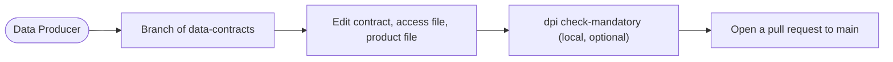
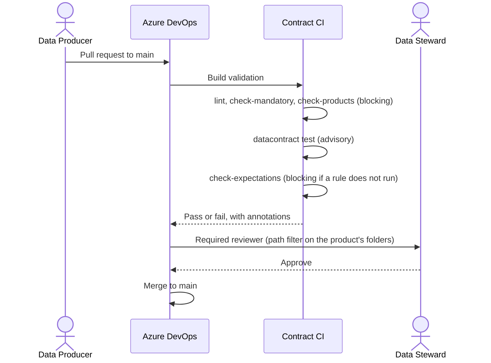
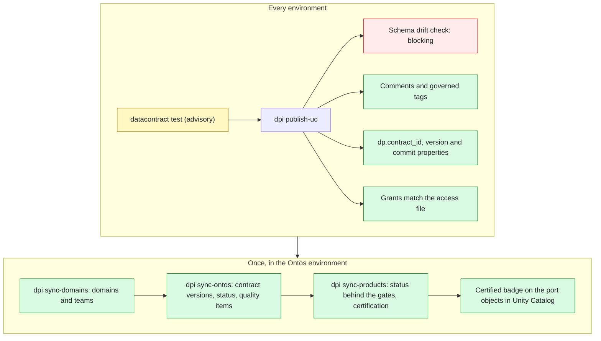
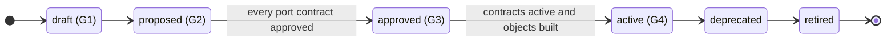
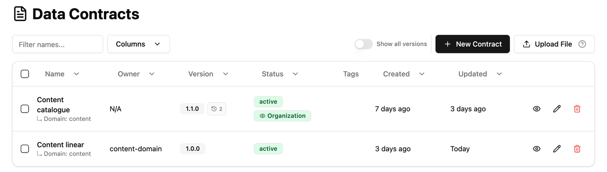
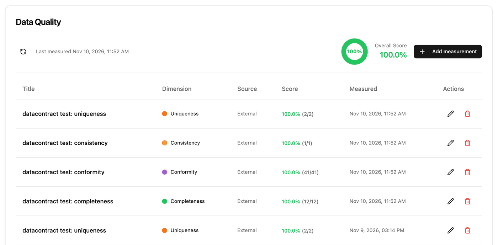
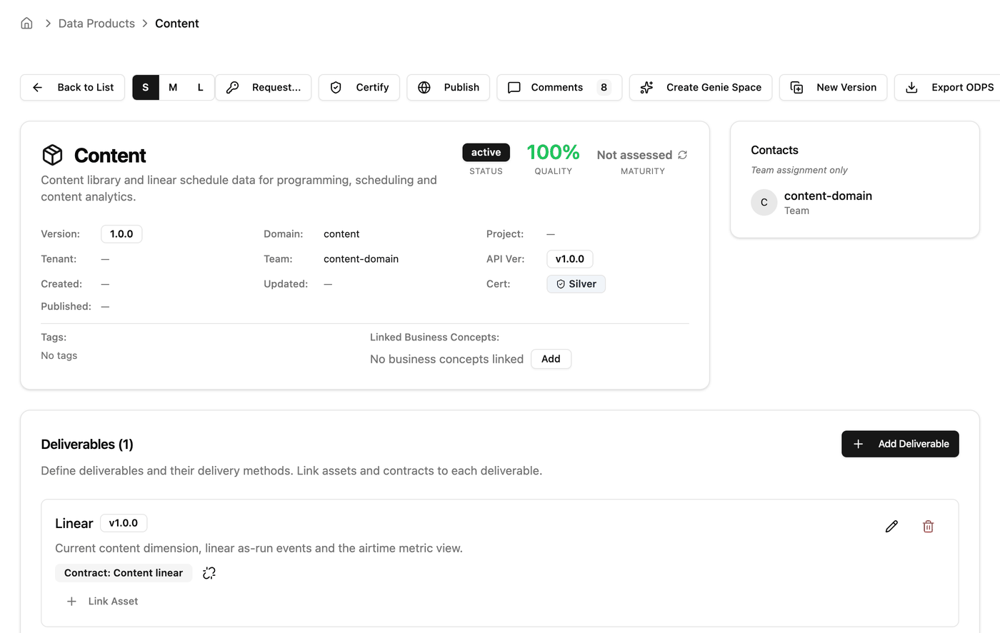
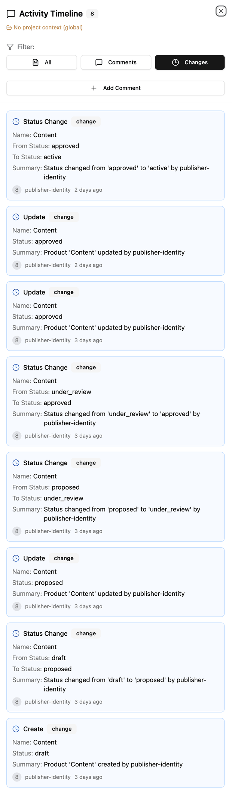

# How it works

Governance here is a set of files in git and the pipelines that act on them. A change to a data
contract or a data product is a pull request. The pipeline checks it against the standard, the
product's Data Stewards sign it off by approving, and after the merge the pipelines make Databricks
and Ontos match what was approved. Nobody applies governance by hand, so what runs is always what
was signed.

The flow has four lanes:

1. [Create](#1-create): a Data Producer writes or changes the contract and the product file.
2. [Review and approve](#2-review-and-approve): contract CI checks the change; the Stewards approve.
3. [Build with the rules embedded](#3-build-with-the-rules-embedded): the product's bundle deploys,
   and the contract's quality rules run as Lakeflow expectations.
4. [Publish and sync](#4-publish-and-sync): Unity Catalog and Ontos are set to match `main`.

To see the result, [what it looks like in Ontos](#what-it-looks-like-in-ontos) walks through the
screens where the states, the quality results and the certification show.

Across all four, a data product moves through [the lifecycle](#the-lifecycle-and-its-gates) from
draft to active, one gate at a time.

| Colour in the diagrams (the label says it too) | Meaning |
|---|---|
| Red | Blocking: a failure stops the change |
| Amber | Advisory: reported as a warning, the change goes on |
| Blue | A person approves |
| Green | Applied by the pipeline |

## Who does what

| Role | Does | Never does |
|---|---|---|
| Data Producer | Writes contracts, product files and the product's bundle; opens pull requests | Approves their own change; grants access by hand |
| Data Steward | Approves the pull requests for the products they steward | Edits Unity Catalog or Ontos directly |
| Platform team | Owns `dp-integration` (the checks, the templates, the configuration) and the domain registry | Approves product changes for a domain |
| Publisher identity | Runs the publish pipeline: tags, comments, grants, Ontos records | Holds a secret: it signs in with workload identity federation |

The checks live in `dp-integration`, a separate repository. The pipeline file in `data-contracts`
only names a template and an environment, so a Data Producer cannot weaken a check in their own
pull request.

## 1. Create

A Data Producer starts on a branch of `data-contracts`. For a new product, `dpi new-product` writes
the three files and a bundle that already pass the blocking checks
([Start a new data product](16-start-a-new-data-product.md)).

| File | Holds |
|---|---|
| `contracts/<domain>/<contract>.odcs.yaml` | The data contract (ODCS 3.1.0): schema, team with the Steward, servers, quality rules, status, version |
| `contracts/<domain>/<contract>.access.yaml` | Who may read or change each object |
| `products/<domain>/<product>.odps.yaml` | The data product (ODPS v1.0.0): its output ports, each naming a contract and version |



## 2. Review and approve

The pull request cannot complete until contract CI passes and a Steward of the product approves.
Branch policies on `main` enforce both, so a direct push is refused.

| Check | What it catches | Effect |
|---|---|---|
| `datacontract lint` | A contract that is not valid ODCS | Blocking |
| `dpi check-mandatory` | A missing Data Steward or Business Data Owner, an unknown domain or status, no governance tier or security classification | Blocking, with an annotation on the line |
| `dpi check-products` | A product whose ports, versions, domain or status do not match the contracts and the registry | Blocking |
| `datacontract test` | Quality rules that flag rows in the current data | Advisory |
| `dpi check-expectations` | A pipeline rule that does not run on the built object | Blocking; flagged rows are only warnings |



The Steward's approval is the Tier 2 sign-off. The publish pipeline runs only on `main`, so it never
asks again. Details: [Contract CI pipeline explained](09-contract-ci-pipeline-explained.md) and
[Branch policies](10-branch-policies.md).

## 3. Build with the rules embedded

Each data product has its own Databricks Asset Bundle. It owns the code and the data, never the
metadata. Its quality rules are not written in the pipeline code: they come from the merged
contract, so a rule changes only through a pull request the Stewards approve.

```mermaid
flowchart LR
    M[Contract merged on main] --> T["deploy.yml contracts trigger"]
    T --> F["bin/fetch-rules.sh: copies the contract and contract_expectations.py"]
    F --> D[Bundle deploy to dev]
    D --> A{{"Environment approval (prod)"}}
    A --> DP[Bundle deploy to prod]
    D --> R["@rules.apply(...): each row-level rule becomes an expectation"]
    DP --> R
    R --> EL[Lakeflow event log: pass and fail counts]
    classDef block fill:#ffebe9,stroke:#cf222e,color:#1f2328
    classDef warn fill:#fff8c5,stroke:#9a6700,color:#1f2328
    classDef sign fill:#ddf4ff,stroke:#0969da,color:#1f2328
    classDef auto fill:#dafbe1,stroke:#1a7f37,color:#1f2328
    class A sign
    class F,D,DP,R auto
```



| In the contract | Becomes the expectation |
|---|---|
| `required: true` on a column | `<column> IS NOT NULL` |
| `nullValues` rule with `mustBe: 0` | `<column> IS NOT NULL` |
| `invalidValues` rule with `validValues` and `mustBe: 0` | `<column> IS NULL OR <column> IN (...)` |
| Any rule with the custom property `expectation` | That SQL expression, row by row |

| `severity` on the rule | Pipeline action |
|---|---|
| `warning` (the default) or `info` | Keeps the row and counts it |
| `error` | Drops the row |
| `critical` | Fails the update |

In the pipeline code a dataset only needs the decorator:

```python
rules = ContractExpectations.from_file(spark.conf.get("contract_path"))

@dp.materialized_view(name="dim_content_current", table_properties=rules.table_properties())
@rules.apply("dim_content_current")
def dim_content_current():
    ...
```

Details: [Data products, bundles and pipeline rules](15-data-products-bundles-and-pipeline-rules.md).

## 4. Publish and sync

After every merge that changes `contracts/`, `products/` or `domains/`, and after every bundle
deploy, the publish pipeline makes Unity Catalog and Ontos match `main`. It runs as the publisher
identity, one stage per environment, each after the one before.



- **Drift fails the run.** If an object's kind or columns differ from its contract, publish skips
  it and fails, so the catalogue never describes a table that is not there.
- **Access is declarative.** With `revoke_unlisted: true` a grant not in the access file is
  revoked. Object owners are never touched.
- **Safe to re-run.** A run with nothing changed makes no comment, grant or Ontos version changes.

Details: [Publish pipeline explained](11-publish-pipeline-explained.md).

## The lifecycle and its gates

The product file's `status` says where the product should be. `dpi sync-products` walks Ontos
there one allowed step at a time, and stops with an error when a gate is not met. Contract CI runs
the same checks without Ontos, so most problems show on the pull request.



| Gate | Status | What must be true | Who moves it |
|---|---|---|---|
| G1 | `draft` | The files exist and pass the blocking checks | Data Producer, Steward approves |
| G2 | `proposed` | Ready for review by consumers | Data Producer, Steward approves |
| G3 | `approved` | Every port contract is at least approved | Steward approves; objects may not be built yet |
| G4 | `active` | Every port contract is active and its objects exist in Unity Catalog | Steward approves after the bundle deploy |

A typical first release is three pull requests: the contract and product to `approved`, then the
bundle, then the contract and product to `active` with any certification.

Ontos has one more step between `proposed` and `approved`: `under_review`. The sync passes
through it on the way, so it shows in the product's history, but a product file never needs to
set it. Before `under_review`, every port contract must be registered in Ontos.

## What it looks like in Ontos

Ontos is the display copy. People read it; the publisher identity writes it. Approval happens in
the pull request, so a contract or product in Ontos moves only after a Steward approved the
change in git. The screens below are from a sandbox install with the synthetic example. The
publisher identity's id is replaced with `publisher-identity`.

### The contracts list

Each contract shows its version, its owner team and its status. A contract with older
versions in Ontos shows a count next to the version; turn on **Show all versions** to list
them. `dpi sync-ontos` registers a new contract version as the next version of the one before,
so Ontos keeps one contract with its history, and walks each version's status to the file's.



### Quality results on each contract version

After `datacontract test` runs in the publish pipeline, `dpi sync-ontos` adds one quality item per
dimension to the contract version, with the passed and total checks. Each run adds a new set, so
the table is also a history. The source is External because the results come from the pipeline,
not from Ontos.



### The data product and its history

The product page shows the current state: status, quality, certification level, the owner team,
and each output port (a deliverable in Ontos) linked to its contract. The Certify and Publish
buttons are not used here: the sync certifies to match `certificationLevel` in the product file.



Comments, then Changes, opens the activity timeline. It lists every change the sync made, newest
first, with the status before and after. Read from the bottom up, this product went from `draft`
through `proposed`, `under_review` and `approved` to `active`, one step per entry. Every entry
names the publisher identity: to see who approved a step, open the pull request that merged it.


